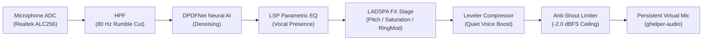

# MicStudio

**High-performance, minimal native Rust audio studio, voice preset manager, and real-time DSP pipeline for PipeWire.**

[](https://www.rust-lang.org/)
[](LICENSE)
[]()
[-red.svg)]()

---


---

## Core Philosophy & Architecture

MicStudio is built for low-latency, zero-bloat audio processing on Linux workstations and gaming laptops (CachyOS / Arch / Fedora).

* **One Persistent Virtual Microphone (`ghelper-audio`)**:
  All games (Counter-Strike 2, Apex Legends, etc.), Discord, OBS, and communication apps capture from a single persistent virtual source (`ghelper-audio`). You never need to change input devices when toggling between clean broadcast speech and creative character presets.
* **Zero-Dropout Preset Switching**:
  Voice modifications (pitch shifting, formant preservation, tube saturation, ring modulation, lo-fi decimation) are updated directly inside the DSP processing engine without tearing down PipeWire nodes or disconnecting active capture streams.
* **DPDFNet AI Neural Denoising**:
  Deep neural noise suppression active across all presets, eliminating mechanical keyboard switches, laptop fans, and ambient room noise without speech distortion.
* **Anti-Shout Guard & Brickwall Limiting**:
  Hardware-safe limiter ceiling at `-2.0 dBFS` prevents distortion and audio clipping during sudden shouts or intense moments.
* **Quiet Voice Boost**:
  Transparent low-level speech leveling (`+4.0 dB` default) ensures whispers and quiet tactical callouts remain crisp and audible without amplifying the noise floor.
* **Resource Discipline**:
  Native Rust with zero Electron or web wrappers. Extremely low CPU (< 1.5% aggregate) and memory (< 40MB) footprint.

---

## Signal Chain



---

## Interactive Terminal UI (TUI)

Launch the interactive studio interface at any time:

```bash
micstudio
```

### Features
* **Dual-Graph Fullscreen Mode (`m` / `M` / `s`)**: High-resolution Real-Time Audio Spectrum Analyzer (50 Hz – 16 kHz) on top, Waterfall Spectrogram Heatmap on bottom.
* **Modal DSP Details (`Space`)**: Press `Space` to inspect the full signal chain, active parameters, and filter status for any highlighted preset without UI clutter.
* **Live Audio Controls**: Adjust DPDFNet suppression, Quiet Voice Boost, Output Gain, Wet/Dry Mix, and Sidetone in real time.
* **Instant Revert & Factory Reset**: Press `c` to instantly return to Natural Clean. Press `r` to restore the selected preset, or `R` (`Shift+R`) to reset all 27 presets to the factory baseline.

### Keybindings Reference

| Hotkey | Action |
| :--- | :--- |
| `j` / `k` / `↑` / `↓` | Navigate presets list (auto-skips category headers) |
| `1` – `9` | Direct jump to preset by index |
| `/` | Filter presets by name or category |
| `Enter` | Apply highlighted voice preset live |
| `Space` | Open full DSP signal chain & parameter modal |
| `m` / `M` / `s` | **Toggle Fullscreen Dual-Graph (RTA Spectrum + Waterfall)** |
| `g` / `G` | Toggle embedded spectrograph mode (RTA Spectrum vs. Waterfall) |
| `Shift+j` / `k` or `Tab` | Cycle through 7 live audio controls |
| `h` / `l` / `←` / `→` | Adjust active control value (`-` / `+`) |
| `v` | Toggle Hear Voice (monitoring readout) |
| `t` | Toggle input level VU meter |
| `c` | Immediately revert to **Natural Clean** |
| `r` | Reset selected preset to factory default parameters |
| `R` (`Shift+R`) | **Reset ALL 27 presets & clean mic to factory baseline** |
| `w` | Save current live tweaks to preset definition file |
| `F5` / `Ctrl+R` | Hot-reload preset definitions from disk |
| `p` | Audition active preset (records 5s sample & plays it back) |
| `?` | Open help & DSP stack dialog |
| `q` / `Esc` | Quit / Close dialog or modal |

---

## CLI Subcommands

MicStudio can be completely controlled via headless CLI commands and scripts:

```bash
# Check current audio engine and virtual microphone status
micstudio status

# Immediately switch to Natural Clean broadcast microphone
micstudio clean

# Reset presets to factory baseline
micstudio reset                   # Resets Natural Clean settings to default (+4dB boost)
micstudio reset all               # Resets all 27 voice models to factory defaults
micstudio reset "Deep Voice"      # Resets specific model parameters

# Switch voice preset
micstudio voice "Deep Voice"
micstudio voice "Robot"
micstudio voice off               # Disables creative FX, keeps clean broadcast

# Adjust Quiet Voice Boost leveling
micstudio boost 4                 # Set boost to +4 dB
micstudio boost off               # Disable quiet speech boost

# Sidetone monitoring
micstudio hear on
micstudio hear off

# Diagnostic audio stack check
micstudio doctor

# Standalone real-time audio spectrograph
micstudio spectrograph
micstudio spectrograph --waterfall

# Offline Audio Lab (deterministic rendering and verification)
micstudio render --preset "Deep Voice" -i input.wav -o output.wav
micstudio verify --preset "Deep Voice"
```

---

## Included Voice Preset Library

MicStudio includes 27 carefully tuned voice presets categorized for gaming and broadcasting:

* **Broadcast & Natural**: `Natural Clean`, `Studio Broadcast`, `Warm Radio`, `Podcast Pro`, `Crisp High-Pass`, `Bass Booster`.
* **Characters**: `Deep Voice`, `Darth Vader`, `Ghostface`, `Cyberpunk Soldier`, `Giant`, `Goblin`, `Demon Lord`, `Orc Warlord`.
* **Sci-Fi & Cyber**: `Robot`, `Cyborg Vocalizer`, `Helldiver Radio`, `Alien Choir`, `Stutter Glitch`, `Ring Modulator`.
* **Retro & Comms**: `Walkie-Talkie`, `Telephone 80s`, `Intercom PA`, `Lo-Fi Radio`, `Helicopter Pilot`.
* **Creative FX**: `Ethereal Space`, `Cosmic Flanger`.

---

## Testing & Verification

MicStudio comes with an automated test suite covering DSP filters, clipping detection, audio streaming, and TUI layouts:

```bash
cargo test
```

* **DSP Pipeline Tests**: Verifies brickwall limiter compliance, hermite resampler accuracy, quiet voice boost compression math, and zero voice duplication.
* **Audio Clipping Tests**: Differentiates between analog hardware ADC clipping and digital brickwall limiting.
* **TUI Layout Tests**: Validates terminal rendering across 80x24 minimal resolution, responsive 100x30 and 200x50 scales, search navigation, and modal rendering without panic.

---

## Building & Installation

### Requirements
* Linux with PipeWire (`>= 0.3.49`)
* `lsp-plugins` (Linux Studio Plugins)
* `ladspa` plugins (`swh-plugins`, `calf`, etc.)
* Rust toolchain (2024 edition)

### Build & Install
```bash
git clone https://github.com/kmanisk/micstudio.git
cd micstudio
cargo build --release
cp target/release/micstudio ~/.local/bin/micstudio
```

---

## License

MIT License. See [LICENSE](LICENSE) for details.
