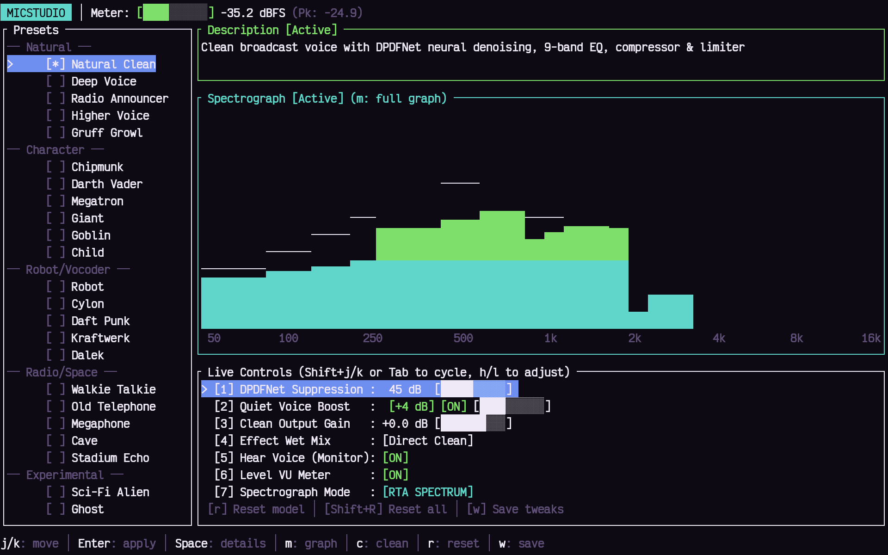
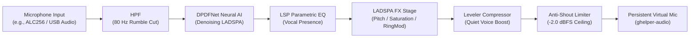

# MicStudio

**High-performance, minimal native Rust audio studio, voice preset manager, and real-time DSP pipeline for PipeWire.**

[](https://www.rust-lang.org/)
[](LICENSE)
[-red.svg)](https://pipewire.org/)

---

## Quick Start

```bash
# 1. Install dependencies and build
cargo build --release && cp target/release/micstudio ~/.local/bin/

# 2. Verify PipeWire virtual mic and LADSPA plugins
micstudio doctor

# 3. Launch interactive studio TUI
micstudio
```

---



---

## Core Philosophy & Architecture

MicStudio is engineered for low-latency, transparent audio processing on Linux workstations and gaming laptops (CachyOS / Arch / Fedora):

* **Single Persistent Virtual Microphone (`ghelper-audio`)**:
  Games (Counter-Strike 2, Apex Legends, etc.), Discord, OBS, and recording applications capture exclusively from one persistent virtual source (`ghelper-audio`). You never need to switch input devices in applications when toggling between broadcast speech and creative presets.
* **Graph-Stable Preset Switching**:
  Voice modifications (pitch shifting, formant preservation, tube saturation, ring modulation, lo-fi decimation) update live inside the DSP processing engine without tearing down PipeWire nodes or disconnecting active capture streams.
* **Universal DPDFNet Neural AI Denoising**:
  Deep neural noise suppression active by default across all presets, eliminating mechanical keyboard clatter, laptop fan hum, and room noise without degrading speech clarity.
* **Anti-Shout Guard & Safety Limiting**:
  Compressor and true peak limiter at a `-2.0 dBFS` ceiling protect against clipping distortion during loud callouts or intense gaming moments.
* **Quiet Voice Boost**:
  Low-level speech leveling (`+4.0 dB` default) ensures quiet whispers and calm tactical callouts remain crisp and audible without amplifying the background noise floor.
* **Resource Discipline**:
  Native Rust architecture with zero Electron or web runtime overhead. Resource consumption remains below 1.5% CPU (measured on ASUS TUF F16 Intel i5-13450HX, Natural Clean preset) and under 40 MB resident RAM.

---

## Live Audio Controls

MicStudio exposes 7 real-time audio parameters in the interactive TUI (cycle via `Tab` or `Shift+J`/`Shift+K`, adjust via `h`/`l` or `←`/`→`):

| Control | Description | Range / Default |
| :--- | :--- | :--- |
| **DPDFNet Denoise** | AI neural noise suppression attenuation floor | 0 – 48 dB (default: `45 dB`) |
| **Quiet Voice Boost** | Transparent speech leveling for whispers and quiet callouts | 0 – 12 dB (default: `+4.0 dB`) |
| **Output Gain** | Master studio makeup and pre-limiter volume trim | -12 to +12 dB (default: `0.0 dB`) |
| **Effect Mix** | Dry/wet balance between clean broadcast speech and creative FX | 0% – 100% Wet |
| **Hear Voice** | Zero-latency sidetone monitor loopback to active headphones | ON / OFF (default: `OFF`) |
| **VU Meter** | Real-time input RMS and peak telemetry bar with clipping hold | ON / OFF (default: `ON`) |
| **Spectrograph** | Live audio frequency visualization (RTA Spectrum or Waterfall) | RTA Bars / Waterfall Heatmap |

---

## Installation & Requirements

### Compatibility
* **OS**: Linux only (CachyOS, Arch Linux, Fedora, Ubuntu 24.04+).
* **Audio Server**: PipeWire (`>= 0.3.49`) with WirePlumber. Standalone PulseAudio and JACK-only setups without PipeWire are unsupported.
* **Display Server**: Fully compatible with both Wayland (Sway, Hyprland, GNOME, KDE Plasma) and X11 (i3, bspwm).

### Package Dependencies

**Arch Linux / CachyOS**:
```bash
# Core audio server, plugins, and dependencies
sudo pacman -S pipewire wireplumber lsp-plugins swh-plugins calf rubberband

# DPDFNet neural noise suppression LADSPA plugin
yay -S hushmic-bin
```

> [!NOTE]
> **DPDFNet Neural Model Source**: The DPDFNet neural model is bundled directly inside `hushmic-bin` (`/usr/lib/ladspa/libdpdfnet_ladspa.so`). The ONNX neural weights are embedded in the shared library; no manual model downloads, Python runtimes, or external checkpoints are required.

**Fedora Linux**:
```bash
sudo dnf install pipewire wireplumber lsp-plugins-ladspa calf ladspa-swh-plugins rubberband
```

### Building from Source

```bash
git clone https://github.com/kmanisk/micstudio.git
cd micstudio
cargo build --release
install -m 755 target/release/micstudio ~/.local/bin/micstudio
```

### First Run & PipeWire Setup

MicStudio interfaces with PipeWire via a virtual filter-chain source node named `ghelper-audio`.

1. Ensure the PipeWire microphone filter-chain configuration is present at `~/.config/pipewire/pipewire.conf.d/40-mic.conf`.
2. Reload PipeWire:
   ```bash
   systemctl --user restart pipewire pipewire-pulse wireplumber
   ```
3. Run diagnostic validation:
   ```bash
   micstudio doctor
   ```
   If all stages report `[✓ PASS]`, `ghelper-audio` is active and ready as your default recording device.

---

## Interactive Terminal UI (TUI)

Launch the interface from any terminal emulator (kitty, alacritty, foot, wezterm):

```bash
micstudio
```

### Keybindings Reference

| Hotkey | Action | Description |
| :--- | :--- | :--- |
| `j` / `k` / `↑` / `↓` | Navigate presets | Moves cursor through voice presets (skips category headers) |
| `1` – `9` | Direct jump | Instantly highlights preset by numeric index |
| `/` | Search filter | Filter presets by name or category; `Enter` commits, `Esc` cancels |
| `Enter` | Apply preset | Applies highlighted voice preset live to the DSP engine |
| `Space` | Inspect DSP modal | Opens full DSP chain, parameter values, and filter telemetry |
| `m` / `M` / `s` | **Fullscreen Dual-Graph** | Toggles full-screen dual view (RTA spectrum on top, waterfall on bottom) |
| `g` / `G` | **Spectrograph mode** | Toggles side-pane spectrograph between RTA spectrum bars and Waterfall heatmap |
| `Shift+J` / `Shift+K` / `Tab` | Cycle controls | Cycles focus across the 7 live audio controls |
| `h` / `l` / `←` / `→` | Adjust control | Decreases or increases value for the currently selected control |
| `v` | Hear Voice | Toggles zero-latency sidetone monitoring |
| `t` | VU meter | Toggles input level meter and peak telemetry |
| `c` | Revert clean | Instantly reverts active microphone to **Natural Clean** |
| `r` | Reset preset | Restores highlighted preset parameters to its factory defaults |
| `R` (`Shift+R`) | **Reset all presets** | Restores all 27 presets & clean mic to the factory baseline |
| `w` | Save tweaks | Persists current live adjustments to `~/.config/micstudio/presets.toml` |
| `F5` / `Ctrl+R` | Reload from disk | Hot-reloads preset definitions from disk |
| `p` | Audition | Records a 5-second sample and plays it back through active sink |
| `?` | Help | Displays keybinding and DSP reference modal |
| `q` / `Esc` | Quit / Close | Closes active modal, or exits the TUI |

---

## Headless CLI Subcommands

MicStudio can be automated via headless CLI commands and shell scripts:

```bash
# Check current audio engine and virtual microphone status
micstudio status

# Immediately switch to Natural Clean broadcast microphone
micstudio clean

# Reset voice presets to factory baseline
micstudio reset                   # Resets active Natural Clean settings (+4dB boost, 45dB denoise, 0dB gain)
micstudio reset all               # Resets all 27 voice models and clean mic to factory defaults
micstudio reset "Deep Voice"      # Resets specific model parameters to factory defaults

# Switch voice preset
micstudio voice "Deep Voice"
micstudio voice "Robot"
micstudio voice off               # Disables creative FX, keeps clean broadcast

# Adjust Quiet Voice Boost leveling
micstudio boost 4                 # Set boost to +4 dB
micstudio boost off               # Disable quiet speech leveling

# Sidetone monitoring (headphones only; protected against speaker feedback)
micstudio hear on
micstudio hear off

# Diagnostic verification of PipeWire nodes and hardware
micstudio doctor

# Standalone real-time audio spectrograph
micstudio spectrograph
micstudio spectrograph --waterfall

# Offline Audio Lab (deterministic rendering and verification)
micstudio render --preset "Deep Voice" -i input.wav -o output.wav
micstudio verify --preset "Deep Voice"
```

---

## Signal Chain



---

## Included Voice Preset Library

MicStudio includes 27 tuned voice models categorized for gaming, broadcasting, and tactical voice chat:

### Broadcast & Natural
* `Natural Clean`: Direct broadcast speech with 45 dB DPDFNet suppression and +4.0 dB Quiet Voice Boost.
* `Studio Broadcast`: Enhanced vocal clarity with presence boost at 2.8 kHz for podcasting and streaming.
* `Warm Radio`: Rich low-end proximity boost reminiscent of vintage FM broadcast microphones.
* `Podcast Pro`: Multi-band vocal leveling with polished broadcast compression.
* `Crisp High-Pass`: Brightened speech tailored to cut through noisy game audio.
* `Bass Booster`: Sub-fundamental enhancement providing deep low-end resonance.

### Characters
* `Deep Voice`: -4 semitone formant-aligned pitch drop for an authoritative vocal profile.
* `Darth Vader`: Heavy mechanical pitch drop combined with modulated acoustic resonance.
* `Ghostface`: Distorted telephone-bandwidth pitch shift with subtle vocal rasp.
* `Cyberpunk Soldier`: Tactical armored comms with mild overdrive and pitch modulation.
* `Giant`: Deep sub-bass resonance with extended spatial presence.
* `Goblin`: High-register pitch shift with emphasized nasal upper harmonics.
* `Demon Lord`: Dual-octave pitch blend with dark harmonic overdrive.
* `Orc Warlord`: Low-frequency growl with saturated mid-range punch.

### Sci-Fi & Cyber
* `Robot`: Fast ring modulation delivering a classic synthetic metallic cadence.
* `Cyborg Vocalizer`: Multi-stage vocoder blending speech with robotic carrier frequencies.
* `Helldiver Radio`: Bandpass comms filter with aggressive limiter punch and simulated military RF choke.
* `Alien Choir`: Multi-voice harmonic shimmer with subtle detuned chorus.
* `Stutter Glitch`: Rhythmic DSP gate chop effect creating a synthetic stuttered vocal.
* `Ring Modulator`: Frequency modulation producing disharmonic sci-fi tones.

### Retro & Comms
* `Walkie-Talkie`: Restricted 400 Hz – 3.5 kHz bandwidth with squelch distortion and radio noise.
* `Telephone 80s`: Vintage carbon-mic telephony bandpass with narrow mid-band presence.
* `Intercom PA`: Public address system emulation with high acoustic reflection and harsh mid-range.
* `Lo-Fi Radio`: 8-bit sample reduction with warm band-limited analog roll-off.
* `Helicopter Pilot`: Harsh aviation headset equalization with rotor-cockpit compression.

### Creative FX
* `Ethereal Space`: Wide ambient reverb tail with spacious spatial diffusion.
* `Cosmic Flanger`: Sweeping multi-phase flanger producing jet-engine vocal modulation.

> [!NOTE]
> Character and title names (`Counter-Strike 2`, `Apex Legends`, `Helldivers`, `Darth Vader`, `Ghostface`) are used strictly for descriptive sound-design reference. MicStudio is an independent open-source project and is not affiliated with or endorsed by any trademark holders.

---

## Configuration & File Locations

| File | Purpose |
| :--- | :--- |
| `~/.config/micstudio/presets.toml` | Voice preset library definitions (pitch, EQ, wet/dry mix, effects) |
| `~/.config/micstudio/settings.toml` | Clean mic preferences (DPDFNet attenuation, Quiet Voice Boost, gain, sidetone state) |
| `~/.config/pipewire/pipewire.conf.d/40-mic.conf` | PipeWire filter-chain graph definition instantiating `ghelper-audio` |

---

## Latency & Performance

* **Model Context Latency**: The DPDFNet neural model operates with an 80 ms context window to perform speech separation without temporal artifacts.
* **DSP Processing Overhead**: Built-in biquad filters, LSP parametric EQ, and limiter stages add < 1 ms of algorithmic latency.
* **Sidetone Latency**: The Hear Voice monitoring loop links directly from `ghelper-audio` to the active playback sink through PipeWire, introducing zero additional buffer latency.
* **Acoustic Feedback Protection**: Sidetone monitoring automatically suppresses loopback when the default sink is set to built-in laptop speakers (`analog-stereo`), preventing infinite feedback loops.

---

## Troubleshooting

### Run Hardware & Stack Doctor
```bash
micstudio doctor
```

### Common Issues

1. **Virtual microphone `ghelper-audio` not showing in Discord, OBS, or Steam**:
   - Verify `40-mic.conf` is loaded:
     ```bash
     pw-dump Node | grep -i ghelper-audio
     ```
   - Restart PipeWire user service:
     ```bash
     systemctl --user restart pipewire wireplumber
     ```

2. **Error loading DPDFNet LADSPA plugin (`libdpdfnet_ladspa.so not found`)**:
   - Ensure `hushmic-bin` is installed:
     ```bash
     ls -l /usr/lib/ladspa/libdpdfnet_ladspa.so
     ```

3. **No audio in Sidetone (`v` key)**:
   - Sidetone requires headphones or a Bluetooth A2DP headset. To protect your hearing and hardware, MicStudio automatically disengages sidetone if output is routed through built-in laptop speakers.

---

## Testing & Verification

MicStudio includes a test suite covering DSP algorithms, clipping detection, audio routing, and TUI layouts:

```bash
cargo test
```

* **DSP Pipeline Tests**: Validates brickwall limiter compliance, hermite resampler accuracy, quiet voice boost compression math, and zero voice duplication.
* **Audio Clipping Tests**: Differentiates between analog hardware ADC clipping (rail saturation) and digital safety limiting (`-2.0 dBFS`).
* **TUI Layout Tests**: Validates terminal rendering across 80x24 minimal resolution, responsive scaling, search navigation, and modal rendering without panic.

---

## Roadmap & Contributing

* [ ] Custom LADSPA chain authoring directly from presets.toml.
* [ ] CLI `--json` output format for status and live audio metrics.
* [ ] Automated audio quality and latency benchmark suite.

Pull requests and issue reports are welcome on [GitHub](https://github.com/kmanisk/micstudio). Please ensure `cargo test` passes prior to submitting PRs.

---

## License

MIT License. See [LICENSE](LICENSE) for details.
